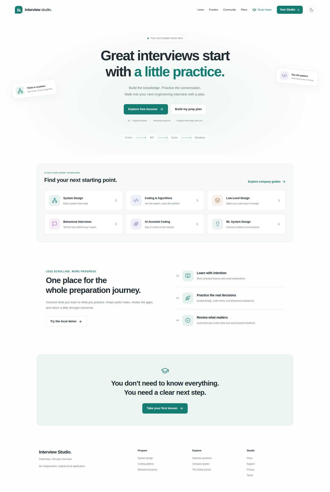

# Interview Studio

An original interview-preparation application inspired by the observable
workflows of Hello Interview. Built with Next.js, React, Auth.js, Prisma and
PostgreSQL.

**This is not Hello Interview, is not affiliated with it, and does not reproduce
its proprietary lessons, videos, branding, interview reports, or production
services. Full feature and content parity has not been achieved.**

See [the reference analysis and feature comparison](docs/REFERENCE-ANALYSIS.md)
for inspected workflows, technical evidence, implementation coverage, and gaps.
The [premium workflow design](docs/PREMIUM-WORKFLOWS.md) explains the original
adaptive interviews, custom quizzes, study plans, and project workbench.
The [researched curricula](docs/CONTENT-CURRICULUM.md) record the System Design,
Coding, and Low-Level Design expansions, sources, depth, and editorial limitations.

The [production application blueprint](docs/production/README.md) reviews the
architecture, social identity and account lifecycle, billing and entitlements,
premium features, operations, and phased delivery plan. The
[Next.js, Auth.js and Prisma migration](docs/production/63-nextjs-authjs-prisma-migration.md)
and [implementation progress](docs/production/07-delivery-roadmap.md#implementation-progress)
record the completed zero-legacy Next.js App Router runtime; authentic
provider acceptance, Azure deployment smoke/rollback evidence and live
operations remain explicit launch gates before Caddy cutover.



## Run locally

Requirements:

- Node.js 24 and npm.
- Google Chrome for browser tests and media generation. The default
  executable is `/usr/bin/google-chrome`; set `CHROME_PATH` for another location.
  CI uses Playwright-managed Chromium, installed with `npx playwright install chromium`.
- A dedicated PostgreSQL 16+ database and synthetic or real Auth.js provider
  configuration.

```bash
npm ci
npm run build
npm run db:migrate
npm run dev
```

Set `DATABASE_URL`, `NEXTAUTH_URL`, `NEXTAUTH_SECRET`, Google/Facebook provider
credentials, `AUTH_INVITED_EMAILS`, `ACCOUNT_ADMISSION_MODE=INVITATION` and
`AUTH_MFA_ENCRYPTION_KEY` in the process environment. Bootstrap an initial
administrator account with:

```bash
npm run bootstrap:admin -- --email admin@example.com --password "Your-Strong-Password-1234"
```

Open **http://127.0.0.1:3000** to sign in with an invited Google account or
verified password credential, manage invitations at `/admin/invitations` (or
under `/staff`), and share one-time `/invite/<token>` links; Facebook remains
link-only from an existing account.

For the standalone release build:

```bash
npm run build
npm start
```

`npm run build` creates `.next/standalone` plus the separately compiled
migration and worker entrypoints in `dist-server`. `npm start` runs the Next.js
standalone server.

For a runtime-only installation, first build with all dependencies installed.
Deploy `.next/standalone`, `dist-server`, `package.json`, and
`package-lock.json` together. Keep environment and data files outside the
artifact.

Screens load on demand while navigation stays available. A screen-load failure
offers explicit navigation or manual reload rather than automatically reloading
or retrying an action; reload may discard unsaved work. The
[screen-delivery runbook](docs/production/28-deferred-screen-delivery.md) records
fixed entry/cold JavaScript budgets and deployment requirements for retaining
old hashed assets across releases. These are not deployed performance SLAs.
Keyboard navigation also has a focusable skip target, readiness-aware screen
focus, dismissible mobile navigation and reliable rapid Search input; see the
[keyboard-navigation boundaries](docs/production/29-keyboard-screen-navigation.md).
Coarse-pointer devices receive 44 CSS-pixel actionable controls across sampled
authentication, shell, learning, community, account and support flows without
changing compact fine-pointer layouts; see the
[touch-target boundaries](docs/production/48-coarse-pointer-touch-targets.md).
Those same compiled flows now have computed light/dark text, placeholder and
keyboard-focus contrast checks with shared-token corrections; see the
[contrast boundaries](docs/production/49-critical-flow-contrast.md).
Authentication, account and support forms also expose stable instruction
associations and preserve native invalid focus without issuing requests; see the
[form-semantics boundaries](docs/production/50-critical-form-semantics.md).
Reduced-motion preferences suppress shared animations, transitions and smooth
scrolling while retaining visible static loading and explicit algorithm steps;
see the [reduced-motion boundaries](docs/production/51-reduced-motion-critical-flows.md).
Compiled critical flows are also checked at 320 CSS pixels with WCAG text-
spacing overrides, while forced-colors mode uses system colors for focus,
current state and progress; see the
[resilient-visual-mode boundaries](docs/production/52-reflow-text-spacing-forced-colors.md).
This is not a complete accessibility assessment or real-device/browser approval.

**This is a production-format Next.js runtime, not an open public or live paid
service.** All legacy Vite, Express, React Router, Auth0/OIDC broker, local
password, demo-plan, gift-code and SQLite service-runtime code has been removed.
Public cutover at `https://interview.genisisiq.com` remains intentionally
fail-closed behind a hardened 503 until authentic-provider, deployment, smoke
and rollback gates pass.

## PostgreSQL and Prisma persistence

PostgreSQL 16+ is the sole application database runtime, accessed through
Prisma Client and reviewed parameterized SQL for locks, compare-and-swap
revisions, PostgreSQL clock decisions and transaction-coupled `pg-boss`
operations. Build the release, configure `DATABASE_URL` in the private
environment, and run the controlled migration command once before starting any
replicas:

```bash
npm run build
npm run db:migrate
npm start
```

The runtime checks migration versions/checksums; it never applies PostgreSQL
migrations or seeds sample accounts/content during startup. Owned learning
collections are persisted as individual rows with transactional updates,
foreign keys, and owner indexes. Draft/story/reflection edits carry revisions
and return explicit conflicts instead of replacing newer work.

No legacy local data is copied automatically. The maintenance-only
`npm run db:import` utility is the only read-only SQLite dependency: it defaults
to a dry run, requires an explicit approved account allowlist and matching
snapshot fingerprint to write, preserves original state bytes for reconciliation,
and excludes passwords, sessions, demo accounts, gifts, and paid-access authority.
Imported accounts require verified identity recovery before signing in.
See [the persistence implementation and migration runbook](docs/production/08-persistence-implementation.md)
for schema details, API revisions, rehearsal, and cutover safeguards.

## What works

Identity and sessions run through **NextAuth/Auth.js Route Handlers** backed by
PostgreSQL. Registration requires an invited Google identity with a verified
email claim; Facebook is link-only from a fresh authenticated Studio session;
email equality never merges accounts; and browser tokens are stored only as
SHA-256 hashes with PostgreSQL-clock absolute/idle expiry, account epochs,
session-bound CSRF, encrypted app-owned TOTP MFA and one-time recovery codes.
See [the Next.js/Auth.js/Prisma migration contract](docs/production/63-nextjs-authjs-prisma-migration.md)
and [the Auth.js TOTP MFA runbook](docs/production/64-authjs-totp-mfa.md).
The [owned support checkpoint](docs/production/26-owned-support-receipts.md)
adds private member request history, retry-safe receipts and shared support
admission. Saved requests are explicitly **not delivered** externally; in-app
staff replies are available under MFA-gated staff operations, while external
email/helpdesk integration and response-time SLAs remain disabled.

Managed accounts use **server-verified PostgreSQL entitlements**:
immutable, source-scoped PostgreSQL grants and revocations; current server-clock
feature decisions; separate content-only versus Pro permissions; and retained
owned archives after expiry. The UI refreshes permissions at scheduled boundaries
without trusting the browser's wall clock. Demo plans never authorize access.
See [the entitlement runbook](docs/production/13-entitlements-implementation.md).

A first **sandbox billing notification checkpoint** adds official Stripe SDK
signature verification, minimized durable acceptance, read-only canonical
observations and a compiled reconciliation worker. It refuses live keys/events
and does not derive entitlements from notification hints. A second **owned
sandbox checkout checkpoint** adds durable server-created customer/session
correlations, fresh authenticated reservation/resume/refresh, stable external
idempotency and a dedicated test-only billing page. Completed sandbox sessions
alone grant no premium access; production purchases and the operated
financial lifecycle remain disabled. See
[the billing notification runbook](docs/production/14-billing-implementation.md);
[the owned checkout runbook](docs/production/15-owned-sandbox-checkout.md).
The [canonical sandbox ledger](docs/production/16-canonical-sandbox-ledger.md)
adds owned subscription/invoice/service-line/payment-reference observations,
dirty-revision reconciliation and retained history. The
[sandbox payment-evidence checkpoint](docs/production/17-sandbox-payment-evidence.md)
traces owned card funding, complete allocations, refunds, disputes and credit
notes, including older targeted invoices. Settled funding alone is not service
or commercial authority. The default-off
[sandbox service-authority checkpoint](docs/production/18-sandbox-service-authority.md)
adds an explicit versioned opt-in for verified calendar service intervals,
immutable expiring Pro grants and invoice-scoped terminal reversal handling.
Without that policy, billing still grants no access; test access never enables
live commerce or external AI. The
[owned sandbox cancellation checkpoint](docs/production/19-owned-sandbox-cancellation.md)
adds fresh authenticated, retry-safe stop-renewal requests and canonical
confirmation without refunding payment, shortening paid access or erasing saved
work. The default-off
[restricted sandbox Portal checkpoint](docs/production/20-restricted-sandbox-portal.md)
adds fresh owned hosted card-method updates and invoice history, without
subscription/profile/login-page changes or payment/access authority. It audits
preparation without retaining bearer URLs and explicitly handles unknown
openings and already delivered links. The
[owned renewal-cycle checkpoint](docs/production/21-owned-sandbox-renewal-cycles.md)
adds acknowledged same-offer sandbox resumption and immutable repeat stop/resume
cycles with exact predecessor tokens, so stale retries cannot affect later
cycles. This changes no paid interval or funding. The
[ended-subscription recheckout checkpoint](docs/production/22-owned-ended-subscription-recheckout.md)
adds exact-parent acknowledged new hosted test purchases on the same customer,
with a scoped current-attempt cursor and retained historical paid sources.
Only independently eligible new invoice evidence can issue a new test interval.
Paid deletion, authentic provider recovery and live commerce remain unavailable.
The [AI usage-ledger foundation](docs/production/23-sandbox-ai-usage-ledger.md)
adds internal atomic allowance/cost accounting and overlap-safe calendar windows,
without enabling managed AI or changing local grading/tutoring.
The [native-intent checkpoint](docs/production/24-owned-ai-native-intents.md)
atomically queues owned accounting intents and cancels known-undispatched work,
with provider dispatch explicitly denied.
The [saved-input provenance checkpoint](docs/production/25-owned-ai-input-provenance.md)
captures bounded private snapshots from actual owned work with immutable
model/prompt/source fingerprints and transactional raw-payload retirement.
The [managed AI native worker checkpoint](docs/production/66-managed-ai-native-worker.md)
adds explicit Azure model/pricing/data-use configuration, consent-gated Next.js
admission for saved practice, mock and project work, owner-only durable status
and cancellation, measured provider cost and atomic Prisma publication. It
remains operationally disabled until authentic Azure, reconciliation, alerting,
retention and deployment acceptance pass.
The [private-safe community-read checkpoint](docs/production/27-private-safe-community-reads.md)
removes public account IDs, derives ownership on the server, and provides bounded
cursor filtering/search/sort with independently addressable full post details.
Global search finds full-body community matches without downloading four
corpora or hiding further matches behind the catalog display cap. Local
contributions remain local; managed writes and moderation are not enabled.
The [opaque-address checkpoint](docs/production/30-opaque-community-addresses.md)
preserves legacy post IDs through shared query-based detail links, exact local
vote/follow/comment identities, and explicit malformed-address recovery.
Existing routes remain compatible; managed community stays read-only.
The [owned-contribution checkpoint](docs/production/31-owned-community-contributions.md)
adds local original-post editing/deletion with current-session ownership,
revision conflicts, exact discussion removal and explicit in-page draft/
lost-response recovery. Illustrative examples remain immutable; managed
owner management is still disabled.
The [owned-comment checkpoint](docs/production/32-owned-comment-editing.md)
adds author-only local text editing, private version snapshots and server-derived
ownership without account IDs. Its shared in-page editor preserves drafts
through conflicts, lost responses, closing and filtering.
The [bounded-discussion checkpoint](docs/production/33-bounded-discussion-pages.md)
replaces the shared UI's 500-comment ceiling with indexed, viewer/resource-bound
pages and explicit load-more/retry controls. Open drafts survive paging and
concurrent edits/creation; new comments appear immediately without duplication.
Search explicitly filters loaded rows, not the complete history.
The [comment-submission receipt checkpoint](docs/production/34-owned-comment-submission-receipts.md)
adds explicit local lost-response check/same-key retry, atomic duplicate-safe
creation and bounded private history without retaining original text in the
receipt ledger. Removed acknowledged comments are never recreated. Managed
writing, retention approval and comprehensive privacy workflows remain open.
The [comment-deletion checkpoint](docs/production/39-recoverable-owner-comment-deletion.md)
adds revision-fenced, UUID-keyed local owner deletion with exact lost-response
retry. It removes saved author/body/account ownership from the comment while a
non-repliable tombstone preserves existing reply context; private receipts retain
no removed text. This is not approved retention, privacy erasure, moderation or
managed writing.
The [staff administration checkpoint](docs/production/35-mfa-staff-account-administration.md)
adds verified OIDC MFA evidence, time-bounded role events, exact masked lookup,
revision-fenced account suspension/reactivation, session revocation and immutable
minimal audit. It does not add impersonation, helpdesk delivery or complete
privacy deletion.
The [durable privacy-export checkpoint](docs/production/36-durable-owner-privacy-exports.md)
adds fresh owner request/download admission, durable comprehensive artifacts,
integrity metadata and explicit failure/expiry states. Artifacts are
inaccessible after 24 hours and the operated worker erases expired bytes;
external storage, email delivery, approved retention, processor erasure and
account deletion are not claimed.
The [owner deletion foundation](docs/production/37-owner-deletion-cooling-off-foundation.md)
adds fresh owner requests, immediate product restriction and peer-session
revocation, restricted sign-in, seven-day in-page cancellation and durable due
work that publishes explicit external blockers instead of false completion.
It performs no physical erasure and does not claim billing, processor,
retention or backup-restore completion.
The [in-app support operations checkpoint](docs/production/38-mfa-in-app-support-operations.md)
adds an MFA-gated bounded staff queue, revision-fenced assignment/status and
idempotent owner-visible replies with immutable evidence. External email,
helpdesk delivery, SLA and staffing claims remain disabled.
The [community moderation checkpoint](docs/production/40-mfa-community-reports-moderation.md)
adds authenticated exact-retry reports, an MFA/role-gated bounded staff queue,
revision-fenced hide/restore state, immutable evidence and consistent public
visibility.
The [community appeal checkpoint](docs/production/41-community-appeals-status-admission.md)
adds exact owner/key/hidden-revision appeals, minimized in-app report/appeal
status, revision-fenced uphold/deny decisions, atomic restoration and shared
PostgreSQL account/network admission for report and appeal writes. External
delivery, automated abuse decisions, staffing, retention approval and managed
community writing remain disabled.
The [personal author-muting checkpoint](docs/production/42-privacy-safe-personal-author-muting.md)
adds exact private mute/unmute receipts, central per-viewer post filtering,
non-interactive muted-comment tombstones, minimized history/privacy exports and
shared managed admission without exposing the muted account. Relationship-wide
blocking follows in the separate checkpoint below; notifications and managed
community writing remain open.
The [reviewed community-restriction checkpoint](docs/production/43-reviewed-expiring-community-restrictions.md)
adds report-bound, MFA/role-gated author-participation and reporter-submission
restrictions with fixed expiry, revision-fenced extension/lift, minimized
member/staff/privacy surfaces and immutable evidence. It does not add automated
enforcement, permanent/global suspension, external restriction notices, an
approved abuse policy or managed writing.
The [restriction-appeal checkpoint](docs/production/44-exact-community-restriction-appeals.md)
adds owner/key/restriction-revision-bound in-app review, independent moderator
decisions, exact atomic uphold/lift and minimized member/staff/privacy surfaces.
It does not promise external delivery, response times, approved policy, staffing
or managed writing.
The [relationship-blocking checkpoint](docs/production/45-privacy-safe-community-account-blocking.md)
adds exact private block/unblock receipts, direction-neutral two-account post
filtering/comment tombstones, relationship-locked direct interaction and
minimized history/privacy exports. It does not remove content globally, notify
the other member, expose block direction or claim an approved interaction
policy.
The [reviewed spam-triage checkpoint](docs/production/46-reviewed-non-punitive-community-spam-triage.md)
adds one bounded, deterministic, versioned suggestion to each new report plus
MFA/role-gated confirm/reject evidence. Suggestions never hide content, change
report state, restrict an account or leave the staff queue; no AI provider or
user-history score is used.
The [bounded browser-runner checkpoint](docs/production/47-bounded-browser-example-runner.md)
adds exact client-side request/result budgets, a private worker reply protocol,
fail-closed parent validation and deterministic cleanup. Visible examples remain
non-authoritative, and the browser is not represented as a reliable memory
sandbox.
The [coarse-pointer checkpoint](docs/production/48-coarse-pointer-touch-targets.md)
adds 44 CSS-pixel control geometry under `pointer: coarse`, enlarged
checkbox/radio label hit areas and production-built checks for undersized,
overlapping or horizontally overflowing targets across sampled critical flows.
It is not broad WCAG, assistive-technology, contrast or physical-device
approval.
The [critical-flow contrast checkpoint](docs/production/49-critical-flow-contrast.md)
computes rendered light/dark text and placeholder contrast through ancestor
background layers and gradient stops, checks the shared keyboard focus outline,
and verifies alert/current-page semantics. Shared muted, accent, error and
placeholder tokens were corrected; broad WCAG, screen-reader, forced-colors,
image-content and alternate-engine approval remain open.
The [critical-form semantics checkpoint](docs/production/50-critical-form-semantics.md)
associates persistent instructions with compiled local auth, profile/password
and support forms, verifies native invalid focus and zero invalid-submit API
requests, and checks live rejected-login and local-support outcomes. It is not
a complete form inventory or hosted identity/payment, assistive-technology,
IME, localization or launch approval.
The [reduced-motion checkpoint](docs/production/51-reduced-motion-critical-flows.md)
disables shared CSS animation/transitions/smooth scrolling, keeps startup and
deferred loading status visible, and stops algorithm auto-play while retaining
manual steps. Dynamic preference changes are exercised in compiled Chromium;
complete vestibular/media, alternate-engine and physical-device review remain
open.
The [reflow/text-spacing/forced-colors checkpoint](docs/production/52-reflow-text-spacing-forced-colors.md)
checks compiled critical flows at 320 CSS pixels with WCAG spacing overrides
and rejects page overflow, clipped direct text and offscreen controls. System-
color focus/current/progress rules are exercised in forced-colors Chromium;
complete low-vision, magnifier, content-state and cross-platform review remain
open.
Controlled PostgreSQL deployments must apply **migration 39 and maintained queue
migration** before this release and preserve the configured service policy when
retained evidence exists.

| Area | Functionality |
| --- | --- |
| Learning | Seven tracks, 74 original lessons; 24 substantial sourced lessons each for System Design and Coding, plus 12 for Low-Level Design, objectives, exercises, outlines, progress, bookmarks, comments, and five algorithm labs |
| Courses | Seven structured paths, including 52-step System Design, 60-step Coding, and 28-step Low-Level Design text/quiz/practice paths |
| Practice | 59 original exercises; 16 worked System Design references, 24 executable Coding exercises, eight worked object models including four runnable stateful exercises |
| Workspaces | Movable architecture nodes and directed connections, diagram export, saved drafts, history, explanation editor, timer, feedback |
| Coding | Dedicated algorithm practice, original reference implementations, complexity analysis, isolated JavaScript `solve(input)` example execution and deadline; code-review line references |
| Behavioral | Micro/mini/full sessions, company and level context, browser speech synthesis, private STAR story CRUD and export |
| Quizzes | 33 topics and 443 questions; System Design and Coding each have 180 sourced questions, plus 80 Low-Level Design questions, canonical scoring, explanations, history, and review |
| Premium mocks | Original topic-adaptive three/five-turn conversations, saved drafts/transcripts, optional managed AI grading, reports and export |
| Custom quizzes | Mixed-topic or missed-only sessions, preserved question order, resume, canonical scores and review-deck updates |
| Study plans | Company/level-focused two/four-week schedules, real progress integration, reflections and export |
| Project workbench | Imported source snapshots, immutable baselines, multi-file editing, isolated JS examples, reviews, exact patch and JSON export |
| Community | Privacy-safe feeds, search, filters, sorting, pagination, discussions, moderation, appeals, personal muting and relationship blocking |
| Discovery | Cross-library search, company/level planning guides, three original journal articles, retrieval-based study helper |
| Identity and privacy | Invited Google sign-in, link-only Facebook, encrypted TOTP MFA + recovery codes, session controls, durable privacy exports and 7-day deletion cooling-off |
| Access, billing and support | Server-verified PostgreSQL entitlements, optional sandbox Stripe Checkout/Portal/reconciliation, and private member support receipts with MFA staff operations |
| Interface | Responsive desktop/mobile navigation, persisted light/dark theme, keyboard shortcuts, focus styles, visible errors |

## Content delivery and saved quiz versions

The browser imports a generated discovery catalog, not lesson bodies, worked
solutions, rubric keywords, or quiz keys. `npm run content:metadata` regenerates
the allowlisted titles/summaries/navigation metadata; development and builds run
it automatically.
Readers and runnable example briefs use authorized, private/no-store Next.js
Route Handlers. The premium concurrency clip/captions live in the server
release, not `.next/static/`, and their endpoint authorizes every request,
including byte ranges.

Topic quizzes issue server-owned, resumable sessions. **Checking or skipping
commits an answer** before its explanation is returned; reload resumes at the
next unanswered question. Topic and custom sessions pin an immutable question
snapshot and use it for grading, report order, citations, and JSON exports even
after a curriculum update. Completed owned reports remain available after
premium expiry. Legacy reports without recorded versions are explicitly labeled;
their original answers/scores remain exportable rather than being rewritten.

See [the protected-content implementation runbook](docs/production/10-content-implementation.md)
for the public/private contract, endpoints, migration 2, version/legacy behavior,
and validation.

A course completion record requires every course step to be complete. It is a
local practice-completion record, not accreditation, hiring evidence, or proof
of mastery. Videos are short original animated walkthroughs, not a substitute
for the reference's video library.

## Durable-job engineering foundation

PostgreSQL deployments include a maintained `pg-boss` queue with transactional
operation/inbox/outbox insertion, stable request idempotency, resource-scoped
claims, safe retry modes, fenced result commits and audited maintenance replay.
`npm run db:migrate` installs the queue explicitly; runtime queue clients never
auto-migrate. `npm run jobs:status` shows private operational metadata without
request bodies.

Compiled worker and maintenance entrypoints under `dist-server/` handle
`privacy:process` / `privacy:worker` for owner export and deletion cooling-off
workflows, `billing:reconcile` / `billing:worker` for sandbox Stripe webhooks,
and `ai:worker` for durable Azure OpenAI evaluations; the Next.js web process
starts none of these workers automatically. See
[the durable-job runbook](docs/production/11-jobs-implementation.md)
for contracts, replay safeguards, retention and actual worker-death/restore
coverage.

## Researched System Design flagship

Open **Learn -> System Design -> Explore the course**, or browse
**[the worked designs](http://127.0.0.1:3000/learn/system-design/cases)**.
The flagship contains 24 lessons, 16 worked designs, and 180 questions informed
by 19 public primary references, including IETF, PostgreSQL, Google SRE, AWS,
Stripe, OWASP, Redis, RabbitMQ, Kafka, Flink, and Jepsen.

The corpus has **43,773 counted instructional words**: 13,945 in lessons,
17,408 in worked reasoning/follow-ups, and 12,420 in answer explanations.
These counts exclude headings, objectives, exercises, assumptions, diagrams,
question prompts, and answer choices. Workloads are hypothetical, not company
benchmarks. Sources are linked in the readers and quiz explanations.

This is an original, source-informed draft curriculum, **not expert-reviewed
material or a verified set of current company interview questions**.

## Researched Coding & Algorithms flagship

Open **Learn -> Coding & Algorithms -> Explore the course**, or browse
**[the worked solutions](http://127.0.0.1:3000/learn/code/solutions)** and
**[dedicated algorithm practice](http://127.0.0.1:3000/practice/code)**.
The 60-step path connects 24 substantial lessons, 12 quizzes containing 180
questions, and 24 original runnable exercises. It covers array patterns,
intervals, stacks, linked lists, binary search, heaps, trees, graph algorithms,
backtracking, dynamic programming, greedy reasoning, tries, matrices, and bits.

Each exercise includes an explicit bounded JSON contract, at least six example
cases, substantial solution reasoning, public sources, and a revealable original
JavaScript implementation. MIT OpenCourseWare, NIST, MDN, and V8 documentation
informed the original material; authenticated reference inspection informed
topic coverage, not copied lesson text. Example tests are **not an exhaustive
online judge**. Reading a reference does not complete an attempt, and local
rubric feedback does not establish algorithm correctness.

The Coding corpus contains **33,748 counted instructional words**: 14,267 in
lessons, 8,710 in solution reasoning, and 10,771 in question explanations, plus
146 executable example fixtures. Code and metadata are excluded. Together with
System Design, the two flagships contain **77,521 instructional words**.

## Researched Low-Level Design expansion

Open **Learn -> Low-Level Design -> Explore the course**, or browse
**[the worked object models](http://127.0.0.1:3000/learn/low-level-design/solutions)**.
The 28-step path connects 12 substantial lessons, eight quizzes with 80
questions, and eight original worked models: parcel lockers, parking, a grid
game, a limiter, an inventory ledger, an LRU cache, an approval workflow, and
an in-memory file catalog.

The last four are **new runnable JavaScript exercises**. The original four
open-ended briefs and starters are preserved; their reference-protocol examples
are not an acceptance harness for those starters. Each model has six specified
traces, an object sketch, substantial reasoning, and explicit complexity and
infrastructure limits. The inventory, cache, workflow, and catalog references
also have independent stateful test oracles.

This expansion contributes **13,824 counted instructional words**: 6,323 in
lessons, 3,118 in worked reasoning, and 4,383 in explanations. The three expanded
disciplines total **91,345 words**, excluding code and metadata. Seven new
primary references from MDN, Martin Fowler, PostgreSQL, and W3C bring the
shared registry to 32.

These are bounded sequential teaching models, **not verified production
transactions, payment providers, distributed caches, or filesystem services**.
The remaining four tracks are still starter-depth. The four short video clips,
generic company guides, and illustrative community entries are unchanged.
None of the expanded curricula has independent human expert review.

## Configuration and optional managed AI

```bash
cp .env.example .env
```

The defaults bind to loopback on port 3000 (`HOSTNAME=127.0.0.1`, `PORT=3000`).
Set `DATABASE_URL` to a dedicated PostgreSQL 16+ database and configure the
Auth.js settings (`NEXTAUTH_URL`, `NEXTAUTH_SECRET`, `AUTH_GOOGLE_CLIENT_ID`,
`AUTH_GOOGLE_CLIENT_SECRET`, `AUTH_FACEBOOK_CLIENT_ID`,
`AUTH_FACEBOOK_CLIENT_SECRET`, `AUTH_INVITED_EMAILS`, and
`AUTH_MFA_ENCRYPTION_KEY`).
For production serving (`NODE_ENV=production`), configure the required
participant policy settings (`PRIVACY_CONTROLLER_NAME`, `PRIVACY_CONTACT_URL`,
`PARTICIPANT_MINIMUM_AGE`, `PRIVACY_RETENTION_NOTICE`,
`PRIVACY_DELETION_NOTICE`, and `PRIVATE_BETA_NO_DURABILITY_ACK=true`) plus
`TRUST_PROXY` for the ingress loopback/CIDR allowlist.
The approved private-beta origin is `https://interview.genisisiq.com`; its
repository-owned Caddy route uses loopback port 10006 and returns an explicit
503 until the service runtime and release gates are ready. See
[the canonical-ingress runbook](docs/production/58-canonical-https-ingress.md)
and [the service launch preflight runbook](docs/production/62-service-launch-preflight.md).
`GET /api/health` checks process liveness; `GET /api/ready` checks PostgreSQL
connectivity, migration history, Auth.js configuration and participant policy.

## CI and private container staging

Application CI builds the Next.js standalone release and worker entrypoints,
runs unit/database/runtime/provider/browser coverage against synthetic
PostgreSQL and Auth.js fixtures, verifies the non-root container, rehearses an
encrypted PostgreSQL dump/restore, and uploads compiled release artifacts.
Actions and container base images are pinned; no live provider keys are required.

```bash
docker build -t interview-studio:staging .
# Inject private POSTGRES_PASSWORD, DATABASE_URL and Auth.js settings through the environment.
# The URL must address database:5432/studio; encode special password characters.
docker compose -f compose.staging.yml up -d --wait
```

The staging compose file exposes the Next.js standalone server only on loopback,
persists PostgreSQL, and requires successful controlled migrations before
starting the web container. It is **private staging, not managed production
infrastructure**. The runtime image uses Node's non-root user.
See [the deployment and recovery runbook](docs/production/09-platform-implementation.md)
and [the standalone release runbook](docs/production/67-next-standalone-release.md)
for release promotion, proxy boundaries, secrets, recovery and remaining gates.

By default, practice feedback uses a labeled **local topic rubric**, and the
study helper retrieves passages from original lessons. They are not AI and are
not represented as AI.

To enable the optional durable managed AI worker (`npm run ai:worker`),
configure the complete all-or-nothing Azure OpenAI and pricing boundary:

```dotenv
MANAGED_AI_ENABLED=true
MANAGED_AI_MODEL_REVISION=gpt-6.1-sol-2026-01
MANAGED_AI_INPUT_PRICE_MICROS_PER_MILLION_TOKENS=250000
MANAGED_AI_OUTPUT_PRICE_MICROS_PER_MILLION_TOKENS=1000000
MANAGED_AI_DATA_USE_NOTICE="Saved submission text is sent to Azure OpenAI for requested evaluation."
AZURE_OPENAI_API_KEY=your-azure-key
AZURE_OPENAI_ENDPOINT=https://your-resource.openai.azure.com
AZURE_OPENAI_DEPLOYMENT=your-deployment
AZURE_OPENAI_API_VERSION=2025-04-01-preview
```

The API key stays server-side. Consent-gated managed AI evaluations queue
durable jobs from saved practice, mock and project snapshots, enforce unit/cost
allowance caps in PostgreSQL, and record provider token/cost provenance.
**Do not submit confidential information.** See
[the managed AI worker runbook](docs/production/66-managed-ai-native-worker.md)
and [the Azure transport boundary](docs/production/54-azure-openai-transport.md).
Reference-site cookies are never used as provider credentials.

## Data and credential boundaries

- PostgreSQL stores accounts, federated identities, SHA-256 session token
  hashes, encrypted TOTP secrets, hashed recovery codes, entitlements, billing
  observations, usage ledgers, progress, drafts, stories, community records,
  support receipts and durable jobs across application restarts.
- Session and CSRF cookies use HttpOnly, SameSite=Lax (with `__Host-` and
  `Secure` on HTTPS); the database stores only SHA-256 token hashes.
- `.cred` was used only for the separate reference-browser inspection. The
  application does not load it. It is ignored by Git and blocked from HTTP
  serving, along with `.env`, Git metadata, and data paths.
- Private authenticated reference screenshots and observations remain outside
  the application. Only original-application screenshots are included here.
- `.env`, runtime databases, dependencies, build outputs, and test artifacts
  are excluded from version control.

The JavaScript runner uses a network-disabled worker in an opaque-origin
sandboxed iframe, with a two-second execution deadline and explicit source,
case, serialized-input, result-size, depth and node limits. A private message
port and parent-side schema validation prevent submitted code from publishing
unchecked success-shaped results, and all frames/workers are removed after
success or failure. Submitted code is never executed on the backend. Only
synchronous JavaScript and client-visible examples are supported; results are
not authoritative grading, the browser has no reliable per-worker memory
quota, and this is not an independent sandbox security approval. See
[the runner boundary](docs/production/47-bounded-browser-example-runner.md).

## Validation and media

```bash
npm run build
npm run test:unit
npm test
npm run test:container
```

- Domain tests check catalogs, canonical scoring, review behavior, streaks,
  entitlements, rubric labels, and course-completion invariants.
- Configuration tests reject invalid settings and verify immutable startup
  snapshots.
- Content tests enforce exact inventory, instructional-depth floors, valid
  source/resource links, difficulty/answer-position coverage, and the arithmetic
  of every worked-design capacity calculation.
- Playwright starts Next.js on port 3100 against a freshly migrated isolated
  PostgreSQL schema and checks anonymous content, deep links, premium gates,
  search, mobile layout and themes.
- Container acceptance verifies the exact standalone image, Auth.js-owned state,
  restart persistence and encrypted backup restore.

Regenerate the four original canvas-animated WebM clips and English VTT captions:

```bash
npm run media
```

## Architecture and limits

`app/` contains the Next.js App Router pages and Route Handlers; `src/` contains
the client screens and components; `shared/` holds original catalogs, types,
course definitions, and domain rules; `server/` implements Auth.js admission,
Prisma/PostgreSQL persistence, entitlements, sandbox billing, managed AI,
community moderation, support, staff administration, privacy workflows and
launch preflight; `prisma/schema.prisma` defines the Prisma relational schema.

**Not connected or equivalent to the reference:** live commercial billing,
transactional email delivery, an external helpdesk or 24/7 support team,
the reference community or proprietary datasets, live BYOE repository/IDE
connectivity, and the reference's proprietary adaptive AI pipeline. The four
generated videos and original catalogs are smaller than the reference's content
library. Public cutover at `https://interview.genisisiq.com` remains behind an
explicit 503 until authentic-provider, deployment, smoke and rollback gates
pass.
